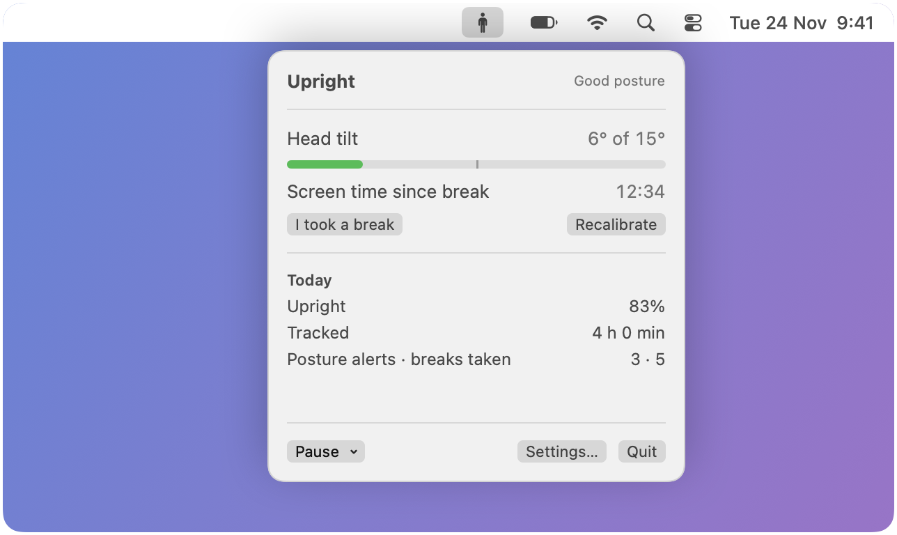
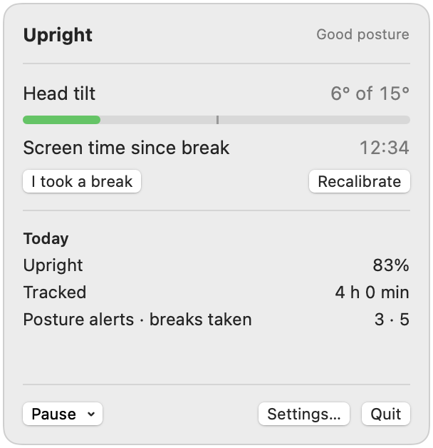

# Upright

A Mac menu-bar app that uses your AirPods' head-motion sensors to tell you when you've been slouching, and reminds you to rest your eyes after long stretches at the screen.

Everything runs on your Mac. No account, no server, and no motion data leaves your machine.

<p align="center">
  <picture><source media="(prefers-color-scheme: dark)" srcset="docs/screenshots/menubar-dark.png"></picture>
</p>

## What it does

- **Posture alerts.** Calibrate once while sitting up straight. If your head stays tilted more than 15° from that position for 2 minutes, you get a notification. A quick look at your phone won't trigger it, and alerts repeat at most every 10 minutes.
- **Eye-break reminders (20-20-20).** After 20 minutes facing the screen, Upright reminds you to look at something 20 ft (6 m) away for 20 seconds. It notices real breaks on its own: looking away for 20 s, moving around, or taking your AirPods out for a minute.
- **Menu-bar status.** The icon shows whether you're upright, slouching or disconnected. The panel shows live head tilt, screen time since your last break, today's upright percentage and alert counts.
- **Settings window.** Tilt limit, how long before an alert, reminder interval and on/off switches for each feature. Pause for 30 min, 1 h or 2 h right from the panel.

## A closer look

### The panel

Click the menu-bar icon to open it. The head-tilt bar fills toward your limit (the tick mark) and turns orange once you pass it.

<table>
  <tr>
    <th>Good posture</th>
    <th>Slouching</th>
  </tr>
  <tr>
    <td><picture><source media="(prefers-color-scheme: dark)" srcset="docs/screenshots/upright-dark.png"></picture></td>
    <td><picture><source media="(prefers-color-scheme: dark)" srcset="docs/screenshots/slouching-dark.png"></picture></td>
  </tr>
</table>

### The menu-bar icon

The icon tells you the state at a glance, without opening the panel.

<p><picture><source media="(prefers-color-scheme: dark)" srcset="docs/screenshots/icons-dark.png"></picture></p>

### Settings

Open it with **Settings…** in the panel. Here you set the tilt limit, how long before a posture alert, and how often to remind you about eye breaks.

<p><picture><source media="(prefers-color-scheme: dark)" srcset="docs/screenshots/settings-dark.png"></picture></p>

## Requirements

- macOS 14 (Sonoma) or later
- AirPods that report head motion: AirPods Pro (any generation), AirPods (3rd generation or later) or AirPods Max, connected to the Mac
- Swift 6 toolchain (Xcode or the Command Line Tools)

## Build and run

```bash
scripts/bundle.sh
open build/Upright.app
```

`bundle.sh` builds with SwiftPM and wraps the binary in an ad-hoc signed `build/Upright.app`. The bundle carries the motion-permission text and runs as a menu-bar-only app. Pass `debug` for a debug build: `scripts/bundle.sh debug`.

On first launch, allow **Motion & Fitness** access and **notifications** when macOS asks. If you missed the motion prompt, turn it on in System Settings → Privacy & Security → Motion & Fitness.

## Using it

1. Put in your AirPods and connect them to the Mac.
2. Click the menu-bar icon, sit up straight, look at your screen, and click **Calibrate** (it takes 3 s).
3. Work as usual. To see an alert quickly, open **Settings**, set **Alert after** to 30 s, and slouch.

Recalibrate if you change chair, desk or monitor height.

## Tests

```bash
swift test
```

The detection logic lives in `UprightCore`, has no Apple-framework dependencies, and is tested with Swift Testing. The tests cover alert timing, hysteresis, cooldown, calibration, break detection, yaw wrap-around and drift.


## Project layout

```
Sources/
  UprightCore/        Pure logic: PostureDetector, BreakTracker, Calibrator, DailyStats
  Upright/            App: MotionService (Core Motion), Notifier, AppModel, menu-bar UI
Tests/UprightCoreTests/
scripts/bundle.sh     Build + app bundle
docs/screenshots/     README images, rendered from the app's own views (Upright --screenshots)
PLAN.md               Roadmap and design notes
```

## Limitations

- It only works while AirPods are worn and connected to the Mac running Upright.
- Detection uses the size of the head tilt, not its direction, so looking up for minutes also counts.
- Alerts appear on the Mac only. iPhone support is on the roadmap.
